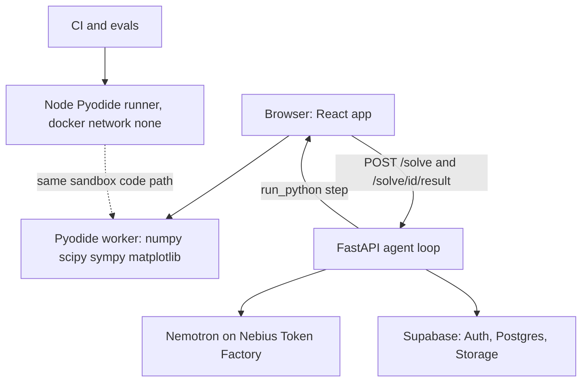

# StudyForge

A study agent for engineering students that can't make up numbers. Nemotron (via Nebius
Token Factory) plans the solution and writes Python, a sealed Pyodide sandbox in the
student's browser does the computing, and the answer is checked before it is explained:
the script must produce a check value that agrees with the answer, and every number in the
explanation must come from the sandbox output or the question. Around the solver sit deadlines and
reminders, quizzes, prep packs, cited web answers, and ChemLab reactor and distillation
simulations.

**Status: work in progress, hackathon build** (Nebius x NVIDIA Global AI Hackathon, Track 2).
Live site: https://studyforge-ten-alpha.vercel.app. It runs in **demo/mock mode** until the
Render and Vercel environment variables and the model key are set (see Demo mode below), so
it is not a fully live solver yet.

`main` holds the web app, the engine (the Nemotron client, the agent loop, the number
guardrail, photo and PDF reading, the quiz engine) and eight ChemLab templates. On the
backend, the FastAPI app, the solve route (mounted with `get_deps`), the Postgres schema
(Alembic migrations under `api/migrations/`), uploads, notes full-text search, notices,
reminders and phone push, prep packs and the hardened CI runner are merged, and CI runs on
every pull request. The solve route answers 503 ("solver not available") until
`DATABASE_URL` and the Token Factory key are set. The Nemotron models have **not been
called yet**, so this README makes no claims about accuracy, latency or cost: **TBD after
Nebius integration**. <!-- TODO(F4): update status after G10 and the first live run -->

## How a solve works

1. **Classify.** The `router` role labels the question `calc` or `concept`. Concept
   questions get a prose answer with no computed numbers.
2. **Notes.** The student's uploaded notes are searched once; hits enter the prompt as
   quoted data, never as instructions.
3. **Solver.** The `solver` role writes one Python script that computes the answer and a
   check value, and the two must agree. The prompt asks for a second route (closed form vs
   numeric, another balance); in practice the model often re-runs the same formula, so the
   check catches sandbox, unit and shape errors more than a wrong formula. (Measured 21 Oct:
   asked explicitly for a different route, it produced one 5 times in 36.) ChemLab templates are not
   used here (they power the ChemLab page), so chat answers no longer include the
   template's stable/unstable steady-state analysis; the ChemLab page shows it. At most 4
   tool steps and 90 s per solve.
4. **Sandbox.** The API returns a `run_python` step; the browser's Pyodide worker runs
   it and posts the result back. The server never executes model-written code.
5. **Verify.** `verify()` requires `answer` and `check` with the same unit that agree
   within 0.1 %. A failure triggers a repair prompt; a disagreement triggers one
   re-solve by a different method (`cross_check` role) and is flagged if it still differs.
6. **Explain.** The solver writes the worked answer from the sandbox result as JSON.
7. **Number guardrail.** Every number in the answer must be within 0.5 % of a sandbox
   value, a number in the question, or a physical constant. Otherwise the answer is
   regenerated once, and flagged with `confidence: "low"` if it still fails.

Every failure ends as a `final` step with low confidence and no unverified numbers, never
an HTTP error.

## Architecture



The sandbox worker (`web/src/sandbox/worker.ts`) removes network APIs (`fetch`,
`XMLHttpRequest`, `WebSocket`, nested workers and others) once user code is about to run,
kills runs after 10 s, caps stdout and figures, and the main thread shape-checks every
message from it. Mermaid diagrams are rendered with `securityLevel: 'strict'` and
re-sanitised with DOMPurify.

## Nemotron usage

`config/models.yaml` is the only place model IDs and prices live. Four roles:

| Role | Used for | Models tried in order | Reasoning |
| --- | --- | --- | --- |
| `router` | classify | nano, super | off |
| `solver` | write the Python, explain, concept answers | super | on |
| `cross_check` | re-solve by a different method | ultra, super | on |
| `vision` | transcribe photos and scanned PDF pages | vision | not sent |

JSON calls always force reasoning off. The client (`api/app/llm/client.py`) uses the
`openai` SDK against the Token Factory base URL with SDK retries disabled, so it can do
its own: up to 3 retries with backoff, a per-role timeout, an absolute per-solve deadline,
fallback down the role's model list, JSON repair, and a cost row per attempt (tokens,
latency, USD once prices are known). A record/replay HTTP transport lets CI run
model-dependent tests without a key.

Model IDs: only `super` (`nvidia/nemotron-3-super-120b-a12b`) is filled in; `nano`,
`ultra`, `vision` and all prices are `null` until ticket G10 confirms them from
`GET /v1/models`. A null model is skipped in its role's chain. Confirmed model IDs,
measured latency and cost per solve: **TBD after Nebius integration**.
<!-- TODO(F4): fill model IDs, measured latency and cost after G10 / first live run -->

The agent has exactly six tools: `run_python`, `search_my_notes`, `web_search`,
`make_quiz`, `schedule_reminder`, `draw_diagram`. Unknown tools are refused in code. In the
deployed wiring `make_quiz` and `schedule_reminder` are real; `search_my_notes` (the notes
search route exists, the tool is not connected yet) and `web_search` still answer "not
available".

## ChemLab templates

Plain numpy/scipy in `chemlab/templates/`, pytest-tested, and written to also run in Pyodide.

- `cstr.py`: liquid-phase CSTR, rate k(T)·CA^n, mole and energy balance; finds all steady
  states (multiplicity), flags stable ones, reports the lowest-temperature stable state.
- `pfr.py`: isothermal PFR, closed-form conversion for any order n.
- `batch.py`: isothermal batch reactor, same kinetics; conversion vs time and time for a
  target conversion.
- `mccabe.py`: McCabe-Thiele binary distillation (constant relative volatility, constant
  molar overflow): minimum reflux, stage stepping, feed stage, tray counts, an illustrative
  column diameter.
- `hx.py`: heat exchanger sizing for a given duty: area by LMTD for counter-flow,
  co-current and 1-2 shell-and-tube (F-correction), checked again by e-NTU; temperature
  profile; tube count and shell size for the drawing.
- `flash.py`: isothermal flash of 2 or 3 compounds (Raoult's law): bubble and dew points,
  Rachford-Rice vapour fraction and compositions, T-x-y diagram.
- `pipe.py`: pipe and pump: Reynolds number, Colebrook friction factor, Darcy-Weisbach and
  fitting losses, pump head and power, system curve.
- `recycle.py`: reactor with recycle and purge, solved with `fsolve` and checked against
  the closed form; overall conversion and inert build-up.
- `_compounds.py`: 40 compounds (critical constants, acentric factor, Antoine constants),
  exported once from the `chemicals` library with the source of every value
  (`chemlab/tools/export_compounds.py`).

Every template's inputs are also exported to `api/app/agent/chemlab_specs.json`
(`chemlab/tools/export_specs.py`), for the template picker (not used in solving for now); a
test fails if the file is out of date.

The ChemLab page (`#chemlab`) has a tab for each of the eight templates: CSTR, Batch, PFR,
McCabe-Thiele, Heat exchanger, Flash drum, Recycle loop, and Pipe and pump.

Visuals: charts on every tab; process flow diagrams for all eight templates; engineering
drawings for the CSTR, the distillation column, the shell-and-tube exchanger and the PFR;
3D views for the CSTR, the column and the exchanger.

## Setup

```bash
git clone https://github.com/studyforge-team/studyforge.git && cd studyforge       # https://github.com/studyforge-team/studyforge
cd web && npm install && npm run dev        # demo mode, no backend needed
pip install -e "./chemlab[dev]" -e "./api[dev]"   # from the repo root
cd api && uvicorn app.main:app --reload     # solve answers 503 without DATABASE_URL and the model key
cp .env.example .env                        # then fill the names (never commit values)
```

## Demo mode

With `VITE_API_URL` unset, the web app uses a scripted mock (`web/src/api/mock.ts`). It
only knows one built-in sample (a first-order CSTR: "CSTR first-order reaction, k = 0.2
1/min, tau = 10 min. Find conversion."); the Python for it really runs in the Pyodide
worker. Any other question gets an honest low-confidence reply saying the model is not
connected. The mock also serves scripted data for the other pages, so the hosted site at
https://studyforge-ten-alpha.vercel.app shows the screens but does not compute your own
questions until `VITE_API_URL`, `VITE_SUPABASE_URL` and `VITE_SUPABASE_ANON_KEY` are set on
Vercel and the Render API has its database and model key.

## Tests

| Suite | Command | Notes |
| --- | --- | --- |
| api | `cd api && pytest` | lint: `ruff check . && mypy app`; needs `pip install -e ./chemlab` |
| chemlab | `cd chemlab && pytest` | also run by CI |
| web e2e | `cd web && npm run test:e2e` | Playwright; builds, then serves a preview |
| web unit | `cd web && node --test tests/errors.test.ts` | Node's built-in test runner |
| web lint | `cd web && npm run lint && npx tsc --noEmit` | oxlint; `npm run build` also runs `tsc -b` |
| runner | `node runner/setup.mjs && node --test runner/test-runner.mjs` | CI/eval runner (S1b); model code runs in docker with `--network none` and an empty env |

CI (`.github/workflows/ci.yml`) runs four jobs on every pull request: api (ruff, mypy,
pytest against a Postgres service, plus the chemlab tests), web (lint, build, unit test,
Playwright), runner, and secrets (gitleaks). `npm test` (vitest) is listed in AGENTS.md but is not defined in
`web/package.json`: the web unit test uses `node --test` instead.

## Folder map

- `api/` FastAPI backend (agent loop, routers, tests)
- `web/` React + Vite + TypeScript frontend, Pyodide sandbox, ChemLab screens
- `chemlab/` simulation templates in plain Python, with tests
- `runner/` hardened Node Pyodide runner for CI and evals (S1b)
- `config/` model registry and settings
- `docs/` architecture, decisions, feedback log

## Licences

StudyForge is MIT licensed (see [LICENSE](LICENSE)). Direct dependencies, licences as read
from installed package metadata (Python: `pip show`; npm: each `package.json`).

**Python** (`api/pyproject.toml`; `chemlab` also needs numpy and scipy):

| Package | Licence |
| --- | --- |
| fastapi, pydantic, pyyaml, PyJWT, sqlalchemy, alembic, pytest, ruff, mypy | MIT |
| openai, asyncpg, python-multipart, types-PyYAML | Apache-2.0 |
| httpx, uvicorn | BSD-3-Clause |
| cryptography | Apache-2.0 OR BSD-3-Clause |
| numpy | BSD-3-Clause (plus bundled permissive terms: 0BSD, MIT, Zlib, CC0-1.0) |
| scipy | BSD-3-Clause (its LICENSE file; the metadata field holds only a copyright line) |
| Pillow | MIT-CMU: **pending team review** against the MIT/Apache/MPL allow-list |
| pypdfium2 | BSD-3-Clause or Apache-2.0, plus bundled dependency licences: **pending team review** |

**npm** (`web/package.json`):

| Licence | Packages |
| --- | --- |
| MIT | react, react-dom, react-markdown, remark-math, rehype-katex, katex, mermaid, three, @types/three, @base-ui/react, @supabase/supabase-js, cn, vite, tailwindcss, @tailwindcss/vite, @vitejs/plugin-react, oxlint, shadcn, @types/node, @types/react, @types/react-dom |
| Apache-2.0 | class-variance-authority, @playwright/test, typescript |
| MPL-2.0 | pyodide |
| MPL-2.0 OR Apache-2.0 | dompurify |

Pyodide's own bundled wheels (numpy, scipy, sympy, matplotlib) carry their upstream
licences. <!-- TODO(F4): P4 to decide on Pillow (MIT-CMU) and pypdfium2 (bundled licences); check the licences of the Pyodide wheels -->

## Team

Built by a team of equals; roles say who builds which ticket first, not who owns what.

| GitHub | Role |
| --- | --- |
| [@ssupreethsg](https://github.com/ssupreethsg) (Supreeth) | P1 Engine & ChemLab (also covering P5) |
| [@ragaveeru-bit](https://github.com/ragaveeru-bit) | P2 Backend & data |
| [@samarthkombli-ops](https://github.com/samarthkombli-ops) | P3 Frontend & sandbox |
| [@sudhanvaad1106-spec](https://github.com/sudhanvaad1106-spec) | P4 Quality & release |
| [@shreyasgoudar251ch056](https://github.com/shreyasgoudar251ch056) (Shreyas) | team member <!-- TODO(F4): confirm Shreyas's role --> |

Contributors and AI assistants: see [AGENTS.md](AGENTS.md).
